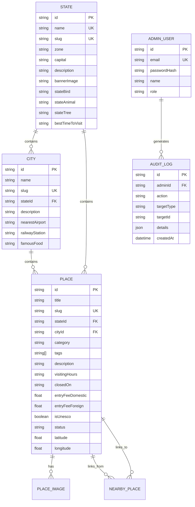

# 📜 Product Requirements Document (PRD)

## Project: TravelBharat – Explore India State by State
**Document Version:** 1.0.0  
**Status:** Approved & Implemented  
**Classification:** Public Educational & Digital Cultural Encyclopedia  

---

## 1. Executive Summary & Vision

### 1.1 Problem Statement
Information regarding India's vast cultural, historical, ecological, and spiritual landmarks is currently fragmented across outdated official portals, commercial booking aggregators, and disorganized blogs. Commercial platforms often obscure crucial civic and historical data in favor of booking funnels and sponsored advertisements. Travelers, educators, and researchers lack a singular, aesthetic, and authoritative digital encyclopedia that catalogs India state by state and city by city.

### 1.2 Product Vision
**TravelBharat** is a definitive, modern digital travel encyclopedia of India. It celebrates India’s heritage by providing structured, verified, and visually immersive destination profiles spanning all 28 States, 8 Union Territories, and 80+ prominent cities without commercial clutter.

### 1.3 Guiding Principles
1. **Informational Purity:** No bookings, no checkout funnels, no commercial bias.
2. **Visual & Cultural Reverence:** An Indian heritage aesthetic (saffron, teal, warm ivory) paired with clean, accessible modern typography and high-definition imagery.
3. **Frictionless Experience:** All public encyclopedic knowledge and personalized bookmarks are accessible without mandatory user account creation.
4. **Editorial Integrity:** Content updates undergo a formal review process enforced through an administrative state machine and audit log.

---

## 2. Target User Personas

| Persona | Role & Context | Primary Needs & Jobs to be Done |
|---|---|---|
| **P1: The Cultural Traveler (Aarav)** | Domestic or international independent traveler planning a regional exploration itinerary. | Needs reliable visiting hours, exact entry fees (domestic vs foreign), ideal visiting seasons, and nearby attraction distances to optimize day trips. |
| **P2: The Academic Researcher / Student (Priya)** | Student or history enthusiast researching regional architecture, monuments, and state symbols. | Needs accurate historical summaries, UNESCO designation status, official state symbols (bird, animal, tree), and official languages. |
| **P3: The Editorial Curator / Admin (Vikram)** | Tourism board volunteer or verified editor maintaining factual accuracy. | Needs a secure dashboard to review draft destination entries, approve updates, inspect audit logs, and monitor catalog completeness. |

---

## 3. Product Scope & Boundaries

### 3.1 In-Scope Capabilities
- **Geographic Coverage:** Full representation of all 28 Indian States and 8 Union Territories grouped by geographic zones (North, South, East, West, Central, North-East).
- **City Coverage:** 80+ documented cities including connectivity points (nearest airport, primary railway junction, national highways) and local culinary highlights.
- **Destination Catalog:** 50+ rich tourist destinations featuring:
  - High-resolution multi-image galleries with responsive lightboxes.
  - Granular entry fee breakdowns (Indian Nationals, Foreign Nationals, Children, Photography/Videography).
  - Operating hours and weekly holiday closures.
  - GPS coordinates and interactive Google Maps redirection.
  - Curated "Insider Tips" for visitors.
  - Automatically calculated distances to nearby places within the same city or state.
- **Search & Discovery Engine:**
  - Instant live search autocomplete across places, cities, and states.
  - Faceted filtering by category (`HERITAGE`, `NATURE`, `BEACH`, `RELIGIOUS`, `ADVENTURE`, etc.), tags, entry fee type (Free / Paid), and UNESCO World Heritage status.
  - 12-Month Best Time to Visit widget showing peak seasonal destinations.
- **Client-Side Bookmarking:** Zero-login bookmarking persisted in `localStorage`.
- **Editorial Admin Console:**
  - Role-Based Access Control (`SUPER_ADMIN`, `EDITOR`).
  - Editorial lifecycle management (`DRAFT` ➔ `IN_REVIEW` ➔ `PUBLISHED` ➔ `ARCHIVED`).
  - Tamper-evident administrative audit logging.
- **Public Feedback:** Contact and correction submission pipeline.

### 3.2 Explicitly Out-of-Scope (Non-Goals)
To preserve the focus, integrity, and performance of the platform, the following features are strictly excluded:
- ❌ **Commercial Bookings & Ticketing:** No ticket reservation engines, seat selection, or bus/train/flight booking systems.
- ❌ **Payment Processing:** No payment gateways (Razorpay, Stripe, UPI) or financial transactions.
- ❌ **Commercial Hotel/Tour Packages:** No sponsored hotel recommendations or commercial affiliate links.
- ❌ **Public User Accounts & Social Logins:** No consumer sign-up, email verification, or social logins (authentication is reserved exclusively for editorial staff).
- ❌ **Public User Reviews & Star Ratings:** No unverified user reviews or subjective star ratings; information remains purely factual and encyclopedic.

---

## 4. Functional Specifications

### 4.1 Module 1: States & Union Territories Atlas (`/states`)
- **F1.1:** System shall list all 36 States and Union Territories.
- **F1.2:** Each State/UT card shall display its banner image, capital, primary language, and badge distinguishing whether it is a State or Union Territory.
- **F1.3:** Users shall be able to filter the atlas by Geographic Zone (`ALL`, `NORTH`, `SOUTH`, `EAST`, `WEST`, `CENTRAL`, `NORTHEAST`).
- **F1.4:** Individual State pages (`/states/[slug]`) shall display:
  - Formal name and regional cultural introduction.
  - State symbols (State Bird, State Animal, State Tree).
  - Best travel seasons and weather summary.
  - List of documented cities within the state.
  - Grid of featured tourist destinations with links to deep-dive pages.

### 4.2 Module 2: City Directory & Transit Connectivity (`/cities`)
- **F2.1:** System shall present city directory entries linked to their parent state.
- **F2.2:** Each city detail page (`/cities/[slug]`) shall include:
  - Connectivity details: Nearest Airport (with code and distance), Railway Junction, and Major Highways.
  - Best months to visit and local climate profile.
  - Signature culinary specialties of the city.
  - Complete list of tourist places located in that city.

### 4.3 Module 3: Destination Encyclopedia (`/places/[slug]`)
- **F3.1:** Display high-resolution hero image and an interactive multi-image thumbnail gallery.
- **F3.2:** Clicking any gallery image shall open a modal lightbox with full-screen view, image caption, and photographer credit.
- **F3.3:** Key metadata callout box displaying:
  - Exact operating hours and regular weekly closing days.
  - Entry fee schedule (Indian Nationals, Foreign Nationals, Camera charges).
  - Recommended visit duration (e.g., "2 - 3 hours").
  - UNESCO World Heritage badge (if applicable).
  - Primary category and descriptive tags.
- **F3.4:** Comprehensive historical background and architectural overview.
- **F3.5:** "Insider Tips" card with practical advice (e.g., sunrise timing, dress code, locker availability).
- **F3.6:** "Getting There" section with transit advice and direct Google Maps navigation button.
- **F3.7:** "Nearby Attractions" section showing other attractions with calculated geodesic distances.
- **F3.8:** Bookmark toggle button allowing users to save/remove destination from their personal list.

### 4.4 Module 4: Faceted Search & Discovery Engine (`/explore`)
- **F4.1:** Keyword search querying destination titles, descriptions, and city names.
- **F4.2:** Filter checkboxes for Categories (`HERITAGE`, `NATURE`, `BEACH`, `RELIGIOUS`, `ADVENTURE`, etc.).
- **F4.3:** Filter checkboxes for Tags (`CULTURAL`, `WILDLIFE`, `HILL_STATION`, `HIDDEN_GEM`, etc.).
- **F4.4:** Filter for Entry Fee (`ALL`, `FREE`, `PAID`).
- **F4.5:** Toggle for UNESCO World Heritage Sites only.
- **F4.6:** Sort dropdown: Alphabetical (`A to Z`, `Z to A`), Most Popular, or Recently Added.
- **F4.7:** Instant search query string synchronization with browser URL for shareable filtered views.

### 4.5 Module 5: Client-Side Saved Destinations (`/saved`)
- **F5.1:** Persist saved destination IDs in `localStorage` under key `travelbharat_saved`.
- **F5.2:** Provide a dedicated view rendering cards of all bookmarked places.
- **F5.3:** Allow single-click removal of bookmarks.
- **F5.4:** Provide a "Clear All" action with confirmation.
- **F5.5:** Display an empty state with a direct call to action to browse the directory when no places are saved.

### 4.6 Module 6: Editorial Admin Console (`/admin`)
- **F6.1:** Secure login at `/admin/login` using email and password against bcrypt-hashed credentials.
- **F6.2:** Set HTTP-only secure cookie and return JWT token upon successful authentication.
- **F6.3:** Dashboard overview displaying:
  - Total places count, published count, review queue count, draft count.
  - Category and State distribution charts.
  - Recent administrative audit events.
- **F6.4:** Places management table with search, status filters, and action buttons to transition publication states:
  - `DRAFT` ➔ `IN_REVIEW`
  - `IN_REVIEW` ➔ `PUBLISHED` or `DRAFT`
  - `PUBLISHED` ➔ `ARCHIVED`
- **F6.5:** System audit log table (`/admin/audit`) displaying chronological records with filtering.

---

## 5. Non-Functional Requirements (NFRs)

### 5.1 Performance & Reliability
- **NFR-1.1:** Initial server response time (TTFB) for public pages shall be under 300ms.
- **NFR-1.2:** Database queries shall be indexed on commonly filtered columns (`slug`, `status`, `category`, `cityId`, `stateId`).
- **NFR-1.3:** Images shall be served via Next.js optimized image loader with WebP conversion, proper aspect ratios, and responsive sizes.

### 5.2 SEO & Structured Data
- **NFR-2.1:** Every destination page shall inject a `TouristAttraction` JSON-LD schema conforming to Schema.org standards.
- **NFR-2.2:** Dynamic Open Graph and Twitter Card meta tags shall be provided on all pages for social preview fidelity.
- **NFR-2.3:** An automated XML sitemap (`/sitemap.xml`) shall dynamically index all states, cities, and places.

### 5.3 Security
- **NFR-3.1:** API rate limiting: General endpoints capped at 100 requests / 15 minutes; login endpoint capped at 5 requests / 15 minutes.
- **NFR-3.2:** HTTP security headers implemented via `helmet` (CSP, HSTS, X-Frame-Options, X-Content-Type-Options).
- **NFR-3.3:** All admin mutations shall verify JWT signature and require valid editor roles.
- **NFR-3.4:** Zod validation applied to all API request bodies to prevent SQL injection or malformed payloads.

### 5.4 Accessibility & UI Standards
- **NFR-4.1:** Contrast ratio of at least 4.5:1 for all standard text (WCAG 2.1 AA).
- **NFR-4.2:** Complete responsive layouts tested across Mobile (375px), Tablet (768px), and Desktop (1280px+).
- **NFR-4.3:** Keyboard-accessible modals and escape-key handlers for the image gallery lightbox.

---

## 6. Data Model Overview

---

## 7. Acceptance Criteria & Definition of Done (DoD)

- [x] All 28 States and 8 Union Territories cataloged with accurate demographic and geographic data.
- [x] Over 80 distinct cities mapped with transit and cultural attributes.
- [x] Over 50 detailed destinations with high-resolution imagery, verified timings, and fee structures.
- [x] Interactive faceted search operational with URL synchronization.
- [x] Personal bookmarking working without account login.
- [x] Admin console allowing publication state transitions with full audit logging.
- [x] 100% passing automated API integration tests (14/14 tests).
- [x] End-to-end browser walkthrough validated across all views.
